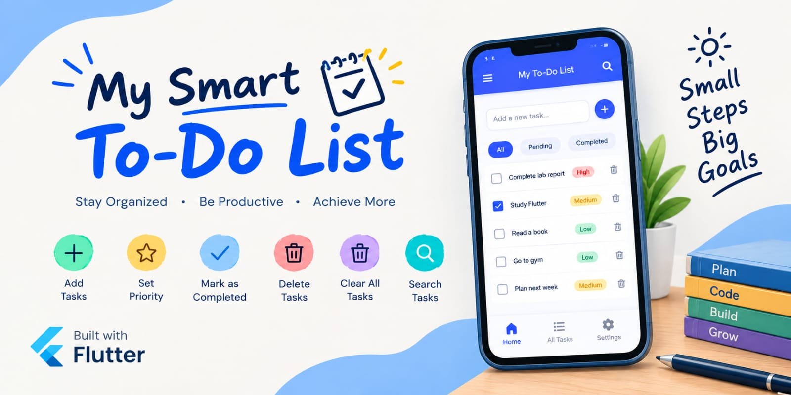

# My Smart To-Do List

## Project Progress

### Commit 1 – Initial Project
Created the basic Flutter To-Do List application.

### Commit 2 – Improve App Title/UI
Updated the application title and improved the UI.

### Commit 3 – Clear All Tasks
Added a button to clear all tasks.

### Commit 4 – Empty Task Validation
Added validation for empty task names.

### Commit 5 – Task Search
Added a search feature to find tasks easily.

Commit 6 - Responsive UI

Implemented a responsive user interface using Flutter layouts to support different screen sizes, including mobile, tablet, and desktop.

Commit 7 - Navigation and Statistics

Added navigation between screens and implemented a Statistics screen to display total, completed, and pending tasks.

Commit 8 - Custom Widgets and Styling

Improved the application design using reusable Flutter widgets, consistent themes, colors, and task priority indicators.

Commit 9 - Animations

Added animations to improve the user interface and provide a smoother user experience.

Commit 10 - REST API Integration

Integrated a REST API to fetch and display tasks from an external source in the API Tasks screen.

Commit 11 - Widget Testing

Added widget tests to verify important application features and help identify errors during development.

## Features

- Add tasks
- Set priority
- Mark tasks as completed
- Delete tasks
- Clear all tasks
- Search tasks

 The following screenshots demonstrate the git commit history and development progress of the Smart To Do List application
 ## 📸 Git Commit Evidence

### Commit 1 Initial Flutter Project

### Commit 2 UI improvements

### Commit 3 Clear All tasks

### Commit 4 Empty task validation

### Commit 5 Search Functionality

### Commit 6  Responsive UI

### Commit 7 Navigate and Statistics

### Commit 8 Widget testing

### Commit 9 REST API Integration

